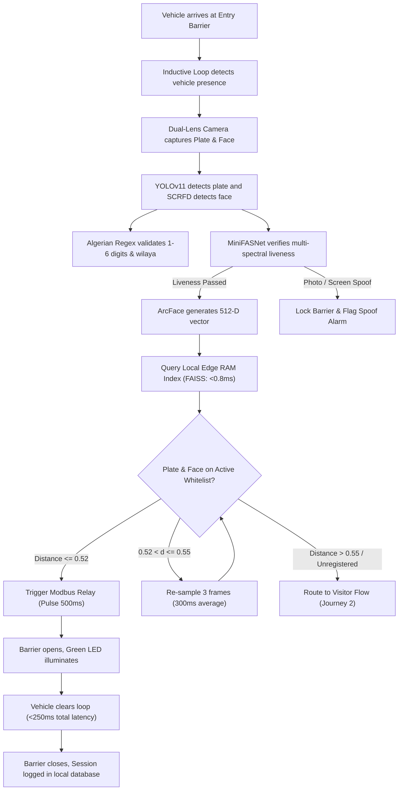
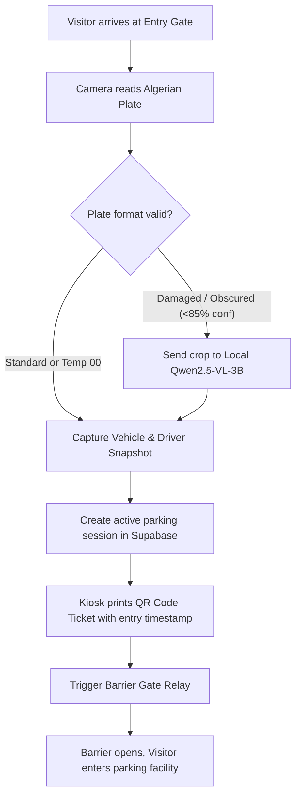
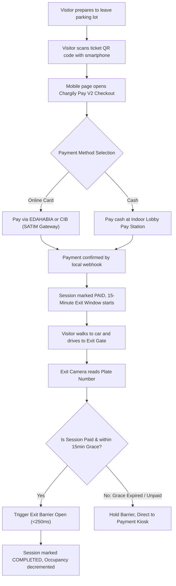
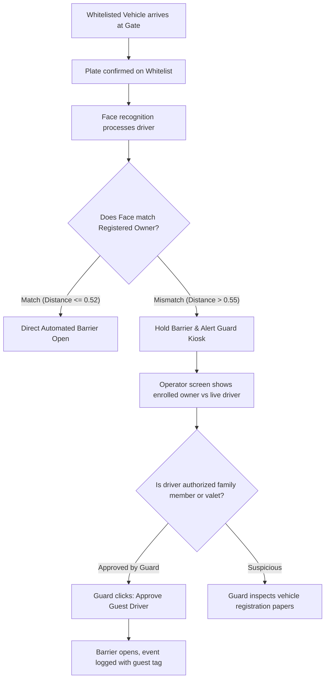
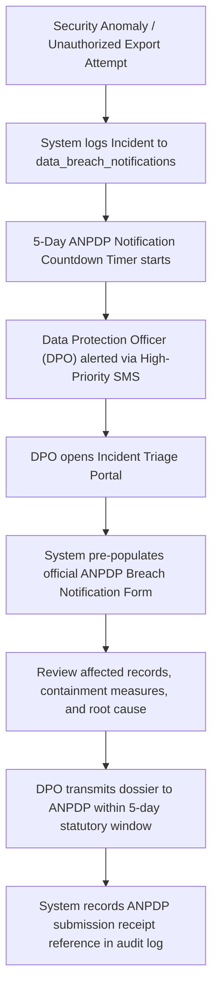
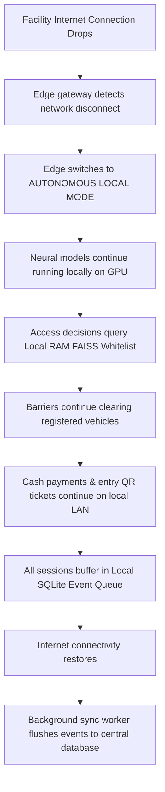

# Smart Park: Master Implementation Blueprint
## Complete System Architecture, Tool Inventory, and Deployment Plan

## 1. Executive Summary and Deployment Profiles

Smart Park is an on-premise, sovereign computer vision and parking access platform engineered for the Algerian regulatory and physical infrastructure. The platform provides automated license plate recognition (ALPR), multi-spectral facial verification with anti-spoofing, parking stall occupancy monitoring, and pre-exit QR payments.

The architecture is designed to support two distinct physical hardware configurations:

```
┌────────────────────────────────────────────────────────────────────────────────────────┐
│ PROFILE 1: SINGLE-PC AUTONOMOUS APPLIANCE (Primary Target Baseline)                   │
│   All services run on one dedicated industrial PC equipped with an NVIDIA GPU:         │
│   • Edge Video Ingestion & Demuxing (MediaMTX)                                         │
│   • TensorRT Computer Vision Engine (YOLOv11n, PaddleOCR, SCRFD, ArcFace, MiniFASNet)  │
│   • Local RAM Vector Search (FAISS in-memory index)                                    │
│   • Local Fallback VLM (Qwen2.5-VL-3B via llama.cpp with CPU/GPU split)                │
│   • Self-Hosted Sovereign Backend (Supabase Docker, PostgreSQL 16, pgvector, MinIO)   │
│   • Local Web Command Center & Guard Display (React 19 / Chromium Kiosk)               │
│   • Hardware Barrier Actuation (Modbus TCP Ethernet Relay)                             │
├────────────────────────────────────────────────────────────────────────────────────────┤
│ PROFILE 2: DUAL-PC DISTRIBUTED CLUSTER (Optional Spare PC Expansion)                   │
│   Workloads split across two networked machines on a local Gigabit switch:             │
│   • PC 1 (Vision Node with GPU): MediaMTX, TensorRT Vision, FAISS RAM, Barrier Relay   │
│   • PC 2 (Spare PC / Application Server): Supabase Docker, MinIO Storage, React App,  │
│           Chargily Pay Webhook Listener, and Guard Booth Control Display               │
└────────────────────────────────────────────────────────────────────────────────────────┘
```

---

## 2. Complete Software and Tool Inventory

Every tool, library, and framework across the entire stack is categorized below:

### 2.1 Video Ingestion and Streaming
* **MediaMTX (`bluenviron/mediamtx`):** Open-source RTSP, RTMP, and WebRTC server written in Go. Ingests raw camera streams directly over the isolated camera network and exposes sub-300ms WebRTC streams for browser monitoring.
* **FFmpeg / OpenCV 4.10 (with CUDA acceleration):** Used for frame extraction, bilinear perspective rectification of plate crops, and color space transformations.

### 2.2 Computer Vision and Deep Learning (TensorRT FP16)
* **YOLOv11n-plate (`ultralytics`):** Compact object detection model fine-tuned for vehicle and license plate bounding box localization. Runs in 6 to 10ms on GPU via TensorRT FP16.
* **PaddleOCR v4 / Fast-Plate-OCR:** Lightweight convolutional and recurrent character recognition engine trained for text reading on rectangular crops.
* **SCRFD-10G (`deepinsight/insightface`):** High-speed face detector returning bounding boxes and 5 facial keypoints in 4ms.
* **ArcFace ResNet50 (`deepinsight/insightface`):** Generates normalized 512-dimensional float32 feature vectors from aligned 112x112 pixel face crops.
* **MiniFASNet (`Silent-Face-Anti-Spoofing`):** Lightweight liveness classification model (3ms on GPU) evaluating chrominance and Fourier frequency gradients to detect paper photo and screen replay attacks.
* **FAISS (`facebookresearch/faiss`):** In-memory vector similarity search library. Executes 1:N cosine distance matching across 10,000 enrolled profiles in under 0.8ms in local RAM.

### 2.3 Local Sovereign Vision Language Model (VLM)
* **Qwen2.5-VL-3B-Instruct (GGUF Q4_K_M):** 3-billion parameter multimodal model serving as the local offline fallback for damaged, dusty, or unreadable plates.
* **`llama.cpp` (`llama-server`):** Inference server executing Qwen2.5-VL with split GPU/CPU layer offloading, strictly limiting VRAM usage to ~3.0 GB and avoiding GPU memory crashes.

### 2.4 Domestic Payment Integration
* **Chargily Pay V2 Python SDK (`chargily-pay-python`):** Located on disk at `D:\TrustDesk\ecosystem_tools\chargily-pay-python/` (mirrored in `D:\Downloads\JP\chargily-pay-python/`). Connects to SATIM domestic payment rails for EDAHABIA and CIB card settlements via automated webhooks.

### 2.5 Local Ecosystem Tools Integration (`D:\TrustDesk\ecosystem_tools/`)
The implementation directly integrates pre-installed ecosystem engines to eliminate redundant custom code:
* **`nocodb` (`ecosystem_tools/nocodb/`):** Connects directly to our self-hosted PostgreSQL database, providing parking administrators and accountants with an out-of-the-box smart spreadsheet interface for vehicle logs, tenant passes, and financial exports without writing custom CRUD screens.
* **`hairline` (`ecosystem_tools/hairline/`):** Zero-dependency isometric vector canvas engine used to render the interactive 2D/3D parking stall occupancy floorplan in the web dashboard.
* **`thinking-orbs` (`ecosystem_tools/thinking-orbs/`):** Lightweight WebGL visual status orbs placed in the command center header to communicate live camera health and AI perception activity (pulsing emerald for active monitoring, amber for review, crimson for alarms).
* **`motion-primitives` (`ecosystem_tools/motion-primitives/`):** Framer Motion and Tailwind micro-interactions for the gate override dock and high-priority alert banners.
* **`BMAD-METHOD` (`ecosystem_tools/BMAD-METHOD/`):** Agile context-engineering framework that shards our implementation PRD and TRD into atomic 900 to 1,600 token story files with pinned Git baselines, keeping coding sprints focused.
* **`ponytail` (`ecosystem_tools/ponytail/`):** Enforces senior developer YAGNI discipline, ensuring minimal custom code and running `ponytail-review` across diffs before committing.

### 2.6 Hardware Controller and Power Management
* **`pymodbus` (Python Modbus TCP library):** Dispatches momentary 500ms dry contact pulses to industrial Ethernet relays connected to barrier gates (BFT, CAME, FAAC).
* **NUT (Network UPS Tools) / `apcupsd`:** Monitors the online double-conversion UPS over USB, providing battery telemetry and automated graceful shutdown policies during extended power cuts.

### 2.7 Sovereign Database and Backend Services
* **Self-Hosted Supabase Docker Stack:** Runs locally on Docker Compose:
  * **PostgreSQL 16:** Relational database engine.
  * **`pgvector` 0.7.0+:** Vector extension storing 512-D embeddings with HNSW indexing.
  * **PostgREST:** Exposes RESTful APIs directly from database schemas.
  * **Supabase Realtime:** WebSocket event server dispatching live gate detections to the browser.
  * **MinIO:** S3-compatible local object storage for encrypted vehicle and plate crops.
  * **Supabase Studio:** Local administrative management interface.

### 2.8 Frontend Command Center
* **React 19 + Vite + Tailwind CSS:** High-performance dark mode web interface with monospace plate rendering, live WebRTC video grid, and keyboard shortcuts.
* **Lucide React:** Minimalist iconography for status indicators.

### 2.9 MCP and Agent Engineering Tools
* **`graphify` MCP:** AST knowledge graph and dependency mapper (17,781 nodes and 22,051 edges indexed). Maps imports, function signatures, and call trees to prevent regressions.
* **`headroom` MCP:** Context window token economy and semantic compression engine for large logs, query outputs, and diffs.

---

## 3. Hardware Architecture and Bill of Materials (BOM)

### 3.1 Hardware Bill of Materials (Turnkey 8-Camera Installation)

All estimates reflect current Algiers commercial technology market pricing:

| Item | Component | Specification | Estimated Cost (DZD) |
| :--- | :--- | :--- | :--- |
| **1** | **Industrial Edge PC** | Intel Core i5 (13th/14th Gen), 32GB DDR5 RAM, NVIDIA RTX 3060 12GB, 512GB NVMe SSD + 2TB SATA SSD, Dual Gigabit NICs | ~230,000 DZD |
| **2** | **Power Conditioning** | **Online Double-Conversion UPS (2kVA / 1800W)** with USB telemetry and pure sine wave inverter | ~120,000 DZD |
| **3** | **Driver Kiosk Cameras (x2)** | Dual-Lens 2MP Global Shutter Camera (Synchronized RGB + 850nm NIR), CPL Polarizing Filter, IP67 housing | ~80,000 DZD (pair) |
| **4** | **ALPR Plate Cameras (x2)** | 4MP Motorized Varifocal Bullet Cameras (5-50mm), Optical WDR (120dB), 1/1000s shutter speed, warm-white LED fill | ~70,000 DZD (pair) |
| **5** | **Overhead Cameras (x4)** | 4MP Wide-Angle Dome Cameras (2.8mm) for parking stalls and aisle surveillance | ~48,000 DZD (set of 4) |
| **6** | **Industrial Network Switch** | 8-Port Gigabit PoE+ Managed Switch (802.3at, 120W power budget) | ~22,000 DZD |
| **7** | **Barrier Gate Relay** | Waveshare 8-Channel Modbus TCP / Ethernet POE Relay Module | ~14,000 DZD |
| **8** | **Inductive Loop Sensors** | Dual-channel vehicle presence loop detector modules | ~16,000 DZD |
| **Total** | **Turnkey Hardware Package** | **Complete On-Site Hardware Procurement** | **~600,000 DZD** |

*Note: If adopting Profile 2 (using a spare PC for Supabase and the guard monitor), you eliminate the need to purchase a separate control-room desktop workstation, saving ~60,000 DZD.*

### 3.2 Network Isolation Topology

```
┌────────────────────────────────────────────────────────────────────────────────────────┐
│ VLAN 10: CAMERA SURVEILLANCE LAN (192.168.10.0/24 - Strictly Isolated)                │
│   ├── Kiosk Cameras, ALPR Cameras, Overhead Cameras                                    │
│   ├── Modbus TCP Barrier Relay Module (192.168.10.200)                                 │
│   └── Connected to Physical Network Port 1 (NIC 1) of the Edge PC                      │
│   * Rule: No default internet gateway; cameras cannot dial external internet IPs.      │
├────────────────────────────────────────────────────────────────────────────────────────┤
│ VLAN 20: FACILITY OFFICE & PAYMENT LAN (192.168.20.0/24)                               │
│   ├── Connected to Physical Network Port 2 (NIC 2) of the Edge PC                      │
│   ├── Outbound internet access for Chargily Pay V2 webhook confirmation                │
│   └── Local control-room browser clients connecting to the web dashboard               │
└────────────────────────────────────────────────────────────────────────────────────────┘
```

---

## 4. Algerian Regulatory Compliance: Law 18-07 and Law 25-11

The installation operates under Algerian data privacy law, enforcing compliance automatically:

1. **Strict Data Sovereignty (Law 18-07 Article 44):** All video feeds, cropped plate images, and biometric face vectors remain within the building on local storage. No biometric records or plate strings cross international borders.
2. **Mandatory DPIA Generation (Law 25-11):** The administrative dashboard includes a module that compiles the mandatory Data Protection Impact Assessment (DPIA) covering proportionality, encryption, and biometric necessity for ANPDP filing.
3. **Automated Register of Processing Activities:** Table `processing_activities_register` logs data subject categories, retention limits, and recipient permissions in real time.
4. **Mandatory 5-Day Breach Notification Workflow:** If unauthorized physical access or database compromise occurs, the system starts a statutory 5-day countdown clock and prepares the official ANPDP incident report.
5. **Automated 30-Day Rolling Purge:** A scheduled database routine permanently scrubs non-flagged video crops and raw biometric vectors after 30 days.

---

## 5. Computer Vision & Optics Calibration

### 5.1 Expanded Algerian Plate Regex Engine
The plate recognition engine accepts standard and transitional plates across all 58 wilayas:
* **Standard Civilian:** `XXXXXX YYY ZZ` (accepting 1 to 6 digits for the sequential registration block, category digits `1` to `9`, year codes, and wilayas `01` to `58`).
* **Temporary Registration:** `XXXXXX 00 ZZ` (accepting provisional `00` middle codes for brand new vehicles).
* **Diplomatic:** Prefixes `CD`, `CC`, `CMD`.

### 5.2 Dual-Lens Multi-Spectral Facial Verification and Anti-Spoofing
* **Visible Spectrum (RGB):** Evaluated by MiniFASNet for chrominance naturalness, screen moiré patterns, and printed paper borders.
* **Infrared Spectrum (850nm NIR):** Bypasses windshield glare and window tint, evaluating natural human skin reflectance.
* **Calibrated Distance Thresholds:**
  $$\text{Cosine Distance} = 1 - \text{Cosine Similarity}$$
  * `Distance <= 0.52`: Immediate match (barrier opens).
  * `0.52 < Distance <= 0.55`: Borderline zone. The engine automatically re-samples and averages embeddings across the next 3 frames (300ms) before making a final determination.
  * `Distance > 0.55`: Unmatched driver (diverted to guard review).

---

## 6. End-to-End Operational Workflows

### 6.1 Journey 1: Whitelisted VIP Entry (Sub-250ms Clearance)



### 6.2 Journey 2: Visitor Entry and QR Ticket Issuance



### 6.3 Journey 3: Pay-on-Foot / Pre-Exit Mobile QR Payment (Zero Gridlock)



### 6.4 Journey 4: Driver-Vehicle Mismatch Anti-Theft Protection



### 6.5 Journey 5: Law 25-11 Mandatory 5-Day Data Breach Triage



### 6.6 Journey 6: Offline Operational Continuity (Internet Failure)



---

## 7. Operator Command Center UI/UX Layout

The interface uses high-contrast industrial styling designed for long shifts:

```
┌──────────────────────────────────────────────────────────────────────────────────────────────┐
│ [LOGO] Smart Park │ Site: Alger Centre (El-Biar) │ 🟢 UPS: ON-LINE (230V) │ 🟢 ALL ONLINE │
├──────────────────────────────────────────────────────┬───────────────────────────────────────┤
│ LIVE CAMERA MATRIX (WebRTC Sub-300ms)                │ REAL-TIME EVENT STREAM (Ticker)       │
│ ┌─────────────────────────┬────────────────────────┐ │ ┌───────────────────────────────────┐ │
│ │ CAM-01: Lane 1 Entry    │ CAM-02: Kiosk Dual-Lens│ │ │ 16:42:10 🟢 ACCESS GRANTED        │ │
│ │ [LIVE RTSP 1080p 25FPS] │ [RGB + 850nm NIR FEED] │ │ │ Plate: 104822 119 16 (Algiers)    │ │
│ │                         │                        │ │ │ Driver: Karim Benali (VIP)        │ │
│ │ Plate: 104822 119 16    │ Liveness: 🟢 LIVE (0.98│ │ │ Liveness: 🟢 Multi-Spectral (0.98│ │
│ │                         │ Match: Karim B. (0.42) │ │ │ Barrier: Opened [Lane 1: 180ms]   │ │
│ ├─────────────────────────┼────────────────────────┤ │ ├───────────────────────────────────┤ │
│ │ CAM-03: Lane 2 Exit     │ CAM-04: Zone A Stalls  │ │ │ 16:41:48 🟡 REVIEW REQUIRED       │ │
│ │ [LIVE RTSP 1080p 25FPS] │ [OVERHEAD MATRIX]      │ │ │ Plate: 08412 00 16 (Temp Plate)   │ │
│ │                         │                        │ │ │ Driver: Unknown Face (Dist: 0.58) │ │
│ │ Plate: 00192 114 09     │ Slots: 184 / 220 Free  │ │ │ [APPROVE GUEST]  [INSPECT ID]     │ │
│ └─────────────────────────┴────────────────────────┘ │ ├───────────────────────────────────┤ │
│                                                      │ │ 16:40:02 🔴 SPOOF ATTEMPT BLOCKED │ │
│ QUICK BARRIER CONTROLS:                              │ │ Plate: 04112 118 16 (Algiers)     │ │
│ [OPEN LANE 1 (Space)] [OPEN LANE 2 (O)] [LOCK ALL]   │ │ MiniFASNet: 🔴 SCREEN REPLAY DETECT │ │
└──────────────────────────────────────────────────────┴───────────────────────────────────────┘
```

---

## 8. Step-by-Step Technical Implementation Sequence

The project execution is organized into sequential engineering sprints:

### Sprint 1: Local Vision Pipeline and Algerian Syntax (Days 1 to 14)
1. Initialize local Python 3.11 virtual environment with PyTorch, CUDA 12.6, and TensorRT.
2. Export `yolov11n.pt` plate detector to TensorRT FP16 engine.
3. Configure PaddleOCR v4 and implement the deterministic Algerian regex parser supporting 1 to 6 digits serials, `00` temporary codes, and wilayas `01` to `58`.
4. Deploy SCRFD-10G face detector, MiniFASNet anti-spoofing model, and ArcFace ResNet50.
5. Implement in-memory FAISS flat inner-product vector search in RAM.
6. Verify pipeline speed: complete detection, liveness check, and FAISS match in under 180ms on GPU.

### Sprint 2: Sovereign Backend and Hardware Relay Control (Days 15 to 30)
1. Set up Docker Compose on the host machine running the self-hosted Supabase stack.
2. Apply [`BACKEND_SCHEMA.sql`](file:///d:/Downloads/park/docs/BACKEND_SCHEMA.sql) to create tables, HNSW indexes, Law 25-11 compliance registers, and stored procedures.
3. Wire the Waveshare Modbus TCP relay to the barrier gate dry contact inputs.
4. Implement the Python relay driver with vehicle presence loop safety interlocks.
5. Deploy `Qwen2.5-VL-3B-Instruct` via `llama.cpp` (`llama-server`) with INT4 quantization, capping VRAM at 3.0 GB.
6. Install and configure `apcupsd` / `NUT` over USB to monitor the 2kVA Online UPS.

### Sprint 3: Pay-on-Foot Engine and Command Center Dashboard (Days 31 to 45)
1. Integrate the Chargily Pay V2 Python SDK (`ecosystem_tools/chargily-pay-python`) to generate pre-exit payment QR codes and process SATIM webhooks.
2. Build the React 19 web dashboard with Vite, Tailwind CSS, and WebRTC streaming.
3. Connect Supabase Realtime channels to display live detections and liveness badges.
4. Implement operator keyboard shortcuts (`Spacebar` to open Lane 1, `O` for Lane 2, `A` to approve guest).
5. Build the Law 25-11 compliance views: DPIA generator, Processing Register viewer, and the 5-day breach notification triage screen.

### Sprint 4: Optical Calibration, Safety Loops & ANPDP Review (Days 46 to 75)
1. Mount dual-lens kiosk cameras with CPL filters and 850nm NIR illuminators.
2. Tune shutter speeds (1/1000s) on ALPR cameras to capture moving plates under night headlights.
3. Conduct 200 consecutive automated gate entries across lighting conditions.
4. Perform intentional network disconnect tests: confirm 100% of whitelisted vehicles clear barriers autonomously via RAM FAISS index.
5. Compile and submit the formal ANPDP compliance dossier under Law 18-07 and Law 25-11.

### Sprint 5: Commissioning, Training & Go-Live (Days 76 to 90)
1. Train security guards on control room keyboard ergonomics and exception workflows.
2. Train the Data Protection Officer (DPO) on the 5-day breach notification workflow and audit logs.
3. Perform final security penetration tests on the isolated Camera VLAN.
4. Official sign-off and commercial deployment.
