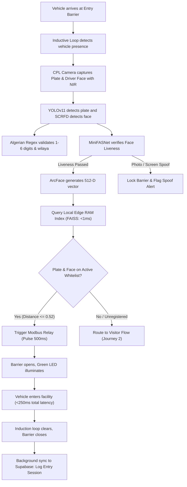
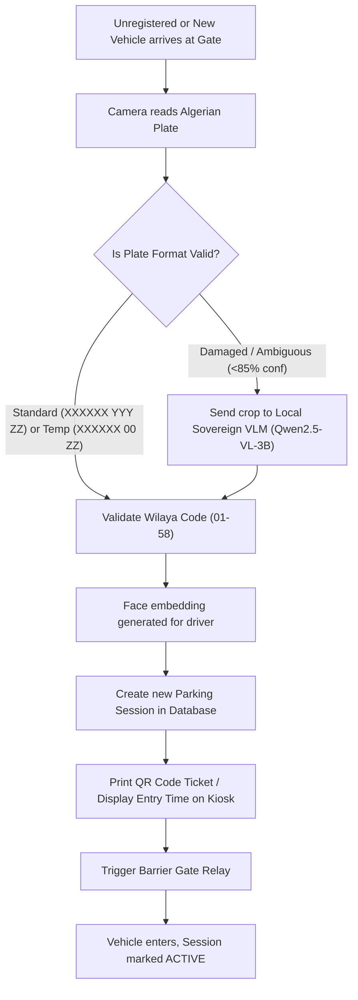
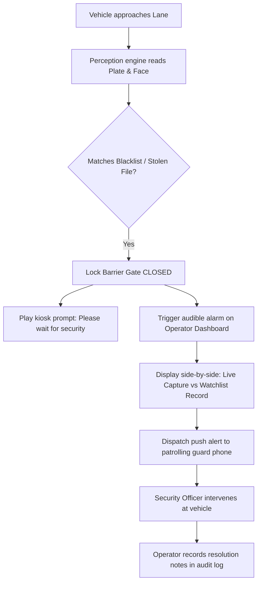
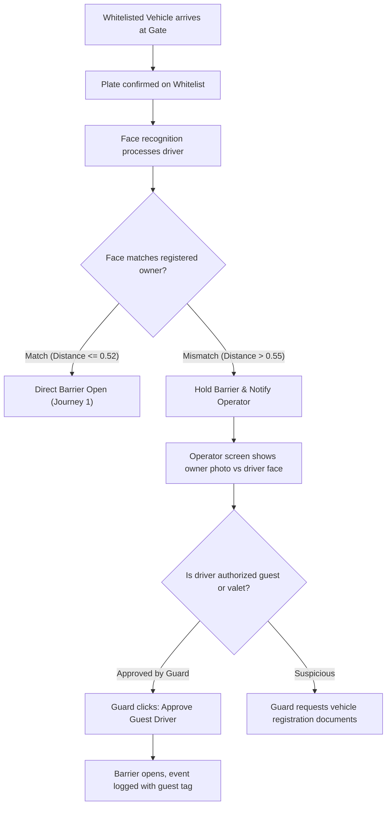
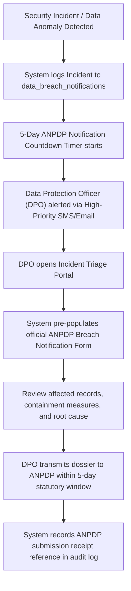
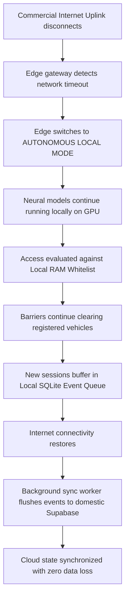

# Smart Park: Master Project Plan and Engineering Specification (V2.0)
## Sovereign Algerian Parking & Security Perception Architecture

## 1. Executive Summary and Project Identity

* **Project Title:** Smart Park (Algeria Sovereign Commercial Edition)
* **Target Environment:** Commercial parking lots, corporate towers, shopping centres, transport hubs, and secure residential compounds in Algeria (Algiers, Oran, Constantine, Sétif, Blida).
* **Core Function:** Real-time AI video perception for automated vehicle barrier clearance, Automatic License Plate Recognition (ALPR) calibrated for Algerian plate formats, driver and pedestrian facial verification, live parking stall occupancy tracking, and security monitoring.
* **Architecture Pattern:** Sovereign hybrid edge-cloud. High-frequency video decoding, neural inference, anti-spoofing, and 1:N vector matching execute locally on an on-premise industrial edge computer in sub-200ms; telemetry, historical logs, and compliance registers operate on a self-hosted Supabase instance deployed on domestic Algerian infrastructure (Algérie Télécom, Icosnet, or on-premise data center). Ambiguous edge cases route to an on-premise local Vision Language Model (Qwen2.5-VL-3B-Instruct) on the edge GPU, guaranteeing zero cross-border biometric transfers.

---

## 2. Algerian Regulatory and Legal Compliance Framework

Commercial automated surveillance and facial processing in Algeria operate under strict statutory regulation. The system integrates technical controls to fulfill legal requirements under the foundational law and its 2025 amendments:

### 2.1 Law 18-07 and Amendment Law 25-11 (24 July 2025)
* **Data Sovereignty (Article 44 Prohibition):** Under Article 44 of Loi n° 18-07, transferring personal biometric data, facial embeddings, or vehicle plate histories outside Algerian national territory without prior ANPDP authorization is prohibited. All video streams, crops, embeddings, and database tables reside on domestic sovereign infrastructure. External cloud APIs are eliminated.
* **Mandatory Data Protection Impact Assessment (DPIA / Analyse d'Impact):** Law 25-11 mandates a formal DPIA before operating any biometric or high-risk tracking system. The platform includes a compliance module that pre-populates standard ANPDP DPIA filings covering necessity, proportionality, risk analysis, and encryption controls.
* **Formal Register of Processing Activities (Registre des activités de traitement):** Law 25-11 requires data controllers to maintain a comprehensive register. The platform automatically maintains table `processing_activities_register`, categorizing data subjects (visitors, employees, subscribers), processed biometric vectors, retention periods, and internal recipients.
* **Mandatory 5-Day Data Breach Notification:** Law 25-11 establishes a strict 5-calendar-day statutory deadline to notify the ANPDP upon discovering any data breach or unauthorized system access. The system features an incident triage module (`data_breach_notifications`) with an automated countdown clock and ANPDP notification generation.
* **Configurable Rolling Data Purge:** Image thumbnails and raw biometric vectors automatically purge from storage after a rolling 30-day window. Only incident-flagged records are retained for security audits.
* **Immutable Audit Trail:** All operator searches, manual gate overrides, and video exports write cryptographic hash entries into an append-only audit ledger (`compliance_audit_logs`).

### 2.2 Physical and Digital Public Notices
The project specification requires bilingual signage (Arabic and French) positioned at entry perimeters notifying drivers that automated license plate reading and camera surveillance operate on site in accordance with Algerian legislation.

---

## 3. Computer Vision and Machine Learning Architecture

```
                                VIDEO PERCEPTION PIPELINE
┌────────────────────────────────────────────────────────────────────────────────────────┐
│ [IP Cameras (RTSP H.264/H.265 @ 1080p over Camera VLAN)]                               │
│         │                                                                              │
│         ▼                                                                              │
│ [MediaMTX / go2rtc (RTSP Demux & WebRTC Re-streamer)]                                  │
│         │                                                                              │
│         ▼                                                                              │
│ [Motion Trigger & Frame Sampler (6 to 10 FPS during active vehicle motion)]            │
│         │                                                                              │
│         ├──────────────────────────────────────────────┐                               │
│         ▼                                              ▼                               │
│ [ALPR Pipeline (YOLOv11n-plate)]              [Facial Pipeline (SCRFD-10G)]            │
│   ├── Bounding Box Extraction                   ├── Face Box & 5 Landmarks             │
│   ├── Perspective Deskew (OpenCV)               ├── MiniFASNet Anti-Spoofing (3ms)     │
│   ├── PaddleOCR v4 / Fast-Plate-OCR             ├── 5-Point Similarity Alignment       │
│   └── Algerian Plate Syntax Validator           └── ArcFace (ResNet50 TensorRT FP16)   │
│         ├── Accepts 1 to 6 digit serials                     │                         │
│         ├── Accepts 00 temp & 3-digit codes                  ▼                         │
│         └── Validates Wilayas 01 to 58              [512-D Normalized Vector]          │
│               │                                              │                         │
│               ├── Conf >= 85%: Local Clean Text              ▼                         │
│               └── Conf < 85%: Local VLM Fallback     [LOCAL RAM 1:N FAISS MATCH]       │
│                     (Qwen2.5-VL-3B INT4 on GPU)              │ (<0.8ms in RAM)         │
│                               │                              │                         │
│                               ▼                              ▼                         │
│                     [Edge Event Controller & Access Gate Decision]                     │
│                               │                                                        │
│                               ├──────────────────────► [Barrier Relay Pulse (Sub-250ms)│
│                               ▼                                                        │
│                     [Local SQLite Event Queue] ──────► [Domestic Supabase Sync Worker] │
└────────────────────────────────────────────────────────────────────────────────────────┘
```

### 3.1 Expanded Algerian License Plate Recognition (ALPR)
The Algerian vehicle registration system uses distinct series that our optical parser handles natively:

1. **Standard Civilian Plates (`XXXXXX YYY ZZ`):**
   * **Block 1 (`XXXXXX`):** Sequential registration number. In high-density wilayas (such as Algiers `16`, Oran `31`, Blida `09`, Constantine `25`, and Sétif `19`), this block spans **up to 6 digits** (e.g., `104822`), while smaller wilayas issue 1 to 5 digits.
   * **Block 2 (`YYY`):** 3-digit category and year code.
     * Digit 1 indicates the vehicle category: `1` (Passenger car), `2` (Truck), `3` (Van), `4` (Bus), `5` (Tractor), `6` (Special machinery), `7` (Special category), `8` (Trailer), `9` (Motorcycle).
     * Digits 2 and 3 represent the registration year (e.g., `24` for 2024, `16` for 2016).
   * **Block 3 (`ZZ`):** 2-digit wilaya code from `01` to `58`.
2. **Temporary New Vehicle Registrations (`00` Series):**
   Brand new vehicles operating on provisional registration cards (cartes grises provisoires) carry the code `00` in the middle block: `XXXXX 00 ZZ` or `XXXXXX 00 ZZ`. The local parser accepts `00` as a valid category code without triggering fallback errors.
3. **Special Series:**
   * **Diplomatic and Consular:** Prefixes `CD`, `CC`, `CMD`.
   * **Temporary Transit:** `WW` series vehicles.

### 3.2 Local Sovereign VLM Fallback (Qwen2.5-VL-3B-Instruct)
When a plate is partially obscured by dirt or damage, or when optical confidence falls below 85%, the frame is processed locally on the edge RTX 3060 GPU using `Qwen2.5-VL-3B-Instruct` (quantized in INT4 via vLLM). It reads characters and identifies vehicle make, model, and color in ~400ms without sending any image data over the internet.

### 3.3 Facial Recognition, Optics, and Anti-Spoofing
* **Optical Glare Countermeasures:** The driver kiosk camera is equipped with a Circular Polarizing Filter (CPL) to cut reflection from angled vehicle windshields and an 850nm Near-Infrared (NIR) floodlight to penetrate tinted glass without blinding drivers.
* **Liveness and Anti-Spoofing:** MiniFASNet (Silent-Face-Anti-Spoofing) evaluates facial texture and depth gradients in 3ms on the GPU, blocking printed photographs and smartphone screen replays (`denied_spoof_detected`).
* **Feature Extraction:** SCRFD-10G locates faces in 4ms; ArcFace generates a normalized 512-dimensional vector.
* **Calibrated Distance Thresholds:**
  $$\text{Cosine Distance} = 1 - \text{Cosine Similarity}$$
  * Barrier Gate Driver Clearance: Distance `<= 0.52` (Similarity `>= 0.48`), calibrated to accommodate through-windshield refraction and window tint.
  * Pedestrian Gate Turnstile: Distance `<= 0.40` (Similarity `>= 0.60`).

### 3.4 Sub-Millisecond Local RAM Vector Matching (FAISS)
To eliminate WAN latency, 1:N vector similarity matching executes entirely in edge RAM:
* 10,000 enrolled vectors of 512 float32 consume only 20.48 MB of RAM.
* FAISS flat inner-product search executes in **under 0.8 milliseconds** on CPU or GPU.
* Barrier clearance operates in sub-200ms, completely decoupled from internet connectivity.

---

## 4. Hardware Topology, Power Protection, and Network Isolation

```
                                 FACILITY NETWORK TOPOLOGY
┌────────────────────────────────────────────────────────────────────────────────────────┐
│ POWER PROTECTION: Online Double-Conversion UPS (2kVA / 1800W)                          │
│   └── Feeds pure sine-wave AC power to Edge PC, Cameras, and Modbus Relays             │
│   └── Zero transfer time (0ms switch) isolates GPU from electrical spikes & sags       │
├────────────────────────────────────────────────────────────────────────────────────────┤
│ VLAN 10: ISOLATED SURVEILLANCE LAN (192.168.10.0/24 - No Public Internet Access)       │
│   ├── Entry Lane IP Camera (1080p RTSP, H.264)                                         │
│   ├── Driver Kiosk Camera (Global Shutter, CPL Polarizer, 850nm NIR Array)             │
│   ├── Exit Lane IP Camera (1080p RTSP, H.264)                                          │
│   ├── Overhead Zone Cameras (1080p RTSP, H.264)                                        │
│   └── Industrial Modbus TCP / Ethernet Barrier Relay (Relay channels 1 to 4)           │
└───────────────────────────────────────────┬────────────────────────────────────────────┘
                                            │ (Physical NIC 1)
                                            ▼
┌────────────────────────────────────────────────────────────────────────────────────────┐
│ ON-PREMISE EDGE GATEWAY INDUSTRIAL PC                                                  │
│   ├── Hardware: Intel Core i5 13th Gen / 32GB RAM / NVIDIA GeForce RTX 3060 12GB       │
│   ├── Software: Ubuntu 24.04 LTS / NVIDIA CUDA 12.6 / TensorRT / Docker                │
│   ├── Local Storage: 512GB NVMe (OS + SQLite Buffer) + 2TB SSD (7-Day Rolling Loop)    │
│   └── In-Memory State: FAISS 512-D Vector Cache (10,000 profiles in ~20 MB RAM)        │
└───────────────────────────────────────────┬────────────────────────────────────────────┘
                                            │ (Physical NIC 2)
                                            ▼
┌────────────────────────────────────────────────────────────────────────────────────────┐
│ VLAN 20: FACILITY WAN UPLINK (Domestic Sovereign Link)                                 │
│   ├── Self-Hosted Supabase Cloud (Algérie Télécom Data Center / Domestic Cloud)        │
│   └── Control Room Browser Clients (WebRTC Live Streams + Dashboard)                   │
└────────────────────────────────────────────────────────────────────────────────────────┘
```

---

## 5. End-to-End Operational Workflows

### 5.1 Journey 1: Whitelisted VIP Entry (Sub-250ms Clearance)



### 5.2 Journey 2: Visitor & Temporary `00` Plate Entry



### 5.3 Journey 3: Blacklisted Plate or Security Watchlist Alert



### 5.4 Journey 4: Driver-Vehicle Mismatch Protocol (Anti-Theft)



### 5.5 Journey 5: Law 25-11 Mandatory 5-Day Data Breach Notification Triage



### 5.6 Journey 6: Offline Operational Resilience (Internet Cut)



---

## 6. UI/UX Command Center Design Specification

### 6.1 Visual Design and Typography
* **Base Surface:** Dark mode industrial slate (`#090D16` canvas, `#111827` cards, `#1F2937` borders).
* **Clearance Green:** `#10B981` (Barrier open, whitelist matched, slot vacant, liveness confirmed).
* **Alarm Crimson:** `#EF4444` (Blacklist alert, gate locked, stolen plate, spoof attempt).
* **Warning Amber:** `#F59E0B` (Driver face mismatch, review required, overstay, UPS battery mode).
* **Stream Cyan:** `#06B6D4` (Active WebRTC camera feed).
* **Native DZD Currency Display:** All fees and financial tallies render in Algerian Dinars: `100.00 DZD`.
* **Typography:** **Inter** for UI controls; **JetBrains Mono** for Algerian license plates, timestamps, and cosine distance metrics.

### 6.2 Operator Dashboard Wireframe

```
┌──────────────────────────────────────────────────────────────────────────────────────────────┐
│ [LOGO] Smart Park │ Site: Alger Centre (El-Biar) │ 🟢 UPS: ON-LINE (230V) │ 🟢 ALL ONLINE │
├──────────────────────────────────────────────────────┬───────────────────────────────────────┤
│ LIVE CAMERA MATRIX (WebRTC Streams)                  │ REAL-TIME EVENT STREAM (Ticker)       │
│ ┌─────────────────────────┬────────────────────────┐ │ ┌───────────────────────────────────┐ │
│ │ CAM-01: Lane 1 Entry    │ CAM-02: Lane 1 Driver  │ │ │ 16:42:10 🟢 ACCESS GRANTED        │ │
│ │ [LIVE RTSP 1080p 25FPS] │ [CPL + NIR FEED]       │ │ │ Plate: 104822 119 16 (Algiers)    │ │
│ │                         │                        │ │ │ Driver: Karim Benali (VIP)        │ │
│ │ Plate: 104822 119 16    │ Liveness: 🟢 LIVE (0.98│ │ │ Liveness: 🟢 Confirmed (0.98)     │ │
│ │                         │ Match: Karim B. (0.42) │ │ │ Barrier: Opened [Lane 1: 180ms]   │ │
│ ├─────────────────────────┼────────────────────────┤ │ ├───────────────────────────────────┤ │
│ │ CAM-03: Lane 2 Exit     │ CAM-04: Zone A Stalls  │ │ │ 16:41:48 🟡 REVIEW REQUIRED       │ │
│ │ [LIVE RTSP 1080p 25FPS] │ [OVERHEAD MATRIX]      │ │ │ Plate: 08412 00 16 (Temp Plate)   │ │
│ │                         │                        │ │ │ Driver: Unknown Face (Dist: 0.58) │ │
│ │ Plate: 00192 114 09     │ Slots: 184 / 220 Free  │ │ │ [APPROVE GUEST]  [INSPECT ID]     │ │
│ └─────────────────────────┴────────────────────────┘ │ ├───────────────────────────────────┤ │
│                                                      │ │ 16:40:02 🔴 SPOOF ATTEMPT BLOCKED │ │
│ QUICK BARRIER CONTROLS:                              │ │ Plate: 04112 118 16 (Algiers)     │ │
│ [OPEN LANE 1 (Space)] [OPEN LANE 2 (O)] [LOCK ALL]   │ │ MiniFASNet: 🔴 SCREEN REPLAY DETECT │ │
└──────────────────────────────────────────────────────┴───────────────────────────────────────┘
```

---

## 7. Backend Database Schema (Supabase PostgreSQL + pgvector)

The complete SQL schema is defined in [`BACKEND_SCHEMA.sql`](file:///d:/Downloads/park/docs/BACKEND_SCHEMA.sql). Key structures include:

* **`facilities`:** Facility profile, wilaya code, capacity, and hourly tariff in DZD.
* **`edge_gateways`:** Gateway status, hardware telemetry, and UPS battery health.
* **`cameras`:** RTSP connection strings, CPL filter status, and NIR illuminator flags.
* **`registered_persons`:** Enrolled tenant, driver, and watchlist profiles.
* **`registered_faces`:** 512-dimensional vector embeddings with HNSW cosine index:
  ```sql
  CREATE INDEX idx_registered_faces_hnsw 
  ON registered_faces 
  USING hnsw (embedding vector_cosine_ops) 
  WITH (m = 16, ef_construction = 64);
  ```
* **`registered_vehicles`:** Whitelisted and blacklisted plates with 6-digit serials, temporary `00` tags, and Algerian wilaya codes.
* **`parking_slots`:** Floor and stall status tracking.
* **`parking_sessions`:** Active and completed parking stays with entry/exit photos and timestamps.
* **`access_events`:** Raw telemetry of every camera detection, liveness score, and barrier relay action.
* **`security_incidents`:** Watchlist hits, driver mismatches, and spoof attempts.
* **`dpia_assessments`:** Data Protection Impact Assessments for Law 25-11.
* **`processing_activities_register`:** Official processing register for ANPDP compliance.
* **`data_breach_notifications`:** 5-day breach notification triage register.
* **`compliance_audit_logs`:** Tamper-proof regulatory audit ledger for Law 18-07 / Law 25-11.
* **Stored Procedures:**
  * `match_face_embedding(...)`: Calibrated 1:N facial search returning matches with Cosine Distance `<= 0.52`.
  * `parse_algerian_plate(...)`: Validates and splits 1 to 6 digit serials, temporary `00` codes, diplomatic series, and valid Algerian wilaya codes (`01` to `58`).
* **Row Level Security (RLS):** Strict multi-tenant isolation policies applied to all tables.

---

## 8. 60-to-90 Day Phased Implementation Roadmap

```
┌────────────────────────────────────────────────────────────────────────┐
│ Phase 1: Edge Vision Engine, 6-Digit & 00 Plates (Days 1 to 14)        │
│   • Set up CUDA 12.6, TensorRT, and MediaMTX on RTX 3060 PC.           │
│   • Deploy YOLOv11n plate detector with 6-digit & '00' syntax parser.  │
│   • Deploy MiniFASNet anti-spoofing and SCRFD-10G + ArcFace models.    │
│   • Implement local in-memory FAISS flat vector index (<0.8ms in RAM). │
├────────────────────────────────────────────────────────────────────────┤
│ Phase 2: Hardware Controller, 2kVA UPS & Sovereign DB (Days 15 to 30)  │
│   • Deploy self-hosted Supabase Docker on domestic Algerian host.      │
│   • Build local SQLite write-ahead queue on edge gateway.              │
│   • Deploy local Qwen2.5-VL-3B-Instruct INT4 on the RTX 3060.          │
│   • Install Online Double-Conversion UPS (2kVA / 1800W) power buffer.  │
│   • Connect Modbus TCP relay to barrier gate with loop safety lock.    │
├────────────────────────────────────────────────────────────────────────┤
│ Phase 3: Command Center Dashboard & Law 25-11 Modules (Days 31 to 45)  │
│   • Build React 19 / Vite command center with WebRTC video matrix.     │
│   • Connect Supabase Realtime subscriptions with liveness indicators.  │
│   • Build Law 25-11 compliance views: DPIA, Register, 5-Day Breach.    │
│   • Implement operator keyboard shortcuts for high-throughput gates.   │
├────────────────────────────────────────────────────────────────────────┤
│ Phase 4: Optical Field Calibration & ANPDP Filing (Days 46 to 75)      │
│   • Align driver kiosk cameras with CPL filters and 850nm NIR arrays.  │
│   • Submit formal ANPDP prior-authorization dossier under Law 25-11.   │
│   • Conduct 200 consecutive automated gate entries across lighting.    │
│   • Disconnect WAN uplink to verify offline RAM FAISS barrier autonomy.│
├────────────────────────────────────────────────────────────────────────┤
│ Phase 5: Commercial Commissioning & Go-Live (Days 76 to 90)            │
│   • Train security operators on keyboard ergonomics and alert triage.  │
│   • Train DPO on 5-day breach notification and audit ledger exports.   │
│   • Final security verification on isolated Camera VLAN.               │
│   • Commercial production go-live signed off by management.            │
└────────────────────────────────────────────────────────────────────────┘
```

---

## 9. Operating Cost Budget in Algerian Dinars (DZD)

To avoid foreign currency card restrictions for Algerian corporate clients, all operational and infrastructure costs are quoted in Algerian Dinars (DZD) with domestic hosting:

| Infrastructure Component | Provider / Solution | Cost (DZD) |
| :--- | :--- | :--- |
| **Edge Hardware Bundle (One-Time Capex)** | Industrial PC + RTX 3060 + 2kVA UPS + CPL Cameras + Modbus Relay | ~380,000 DZD (one-time) |
| **Domestic Cloud Hosting** | Self-hosted Supabase on Algérie Télécom / Icosnet / Local VPS | ~6,500 DZD / month |
| **Local Vision & VLM Inference** | Local GPU Execution (YOLOv11 + ArcFace + Qwen2.5-VL) | 0.00 DZD (Zero API fees) |
| **On-Site Maintenance & Support** | Hardware SLA with on-site replacement guarantee | ~15,000 DZD / month |
| **Total Monthly Operating Cost** | **Sovereign Domestic Stack** | **~21,500 DZD / month** |

This sovereign edge-cloud architecture cuts recurring software fees to zero, keeps all personal biometric data within Algeria, and guarantees sub-250ms barrier opening speeds even during commercial internet outages.
