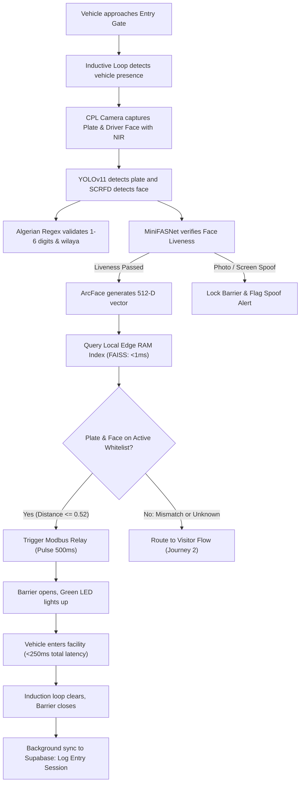
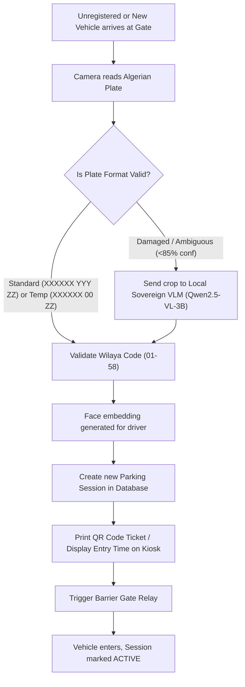
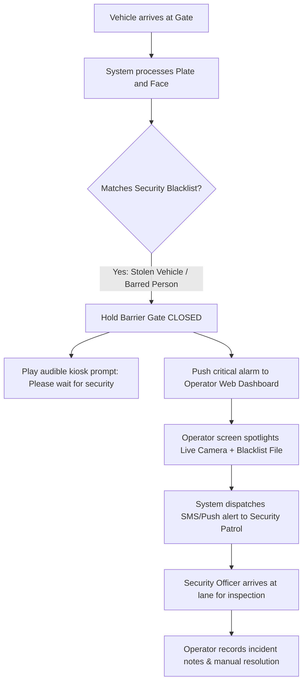
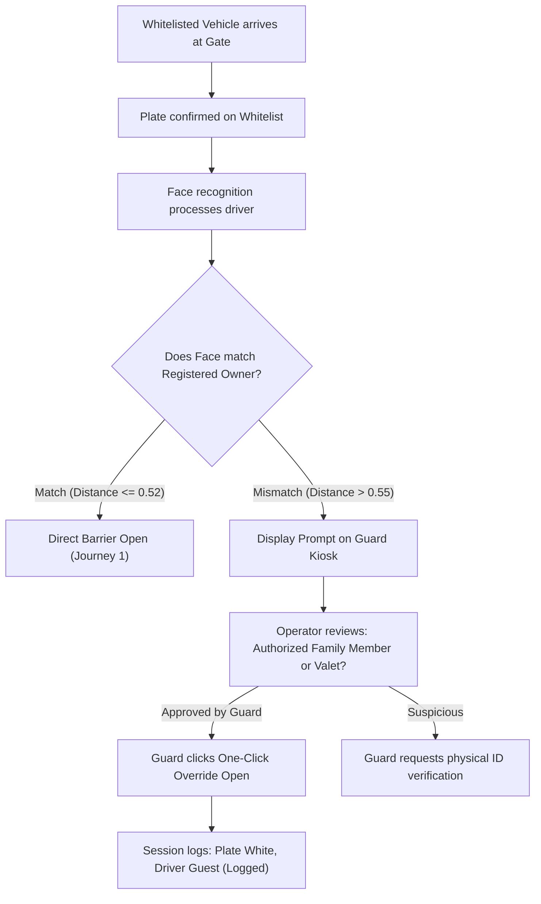
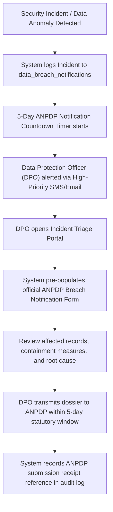

# Application Flows and User Journeys (V2.0)
## Smart Park (Algeria Sovereign Edition)

## 1. Primary Operational Workflows

This document specifies the step-by-step user journeys and system state machines for gate entry, liveness verification, parking slot guidance, payment processing, and Law 25-11 regulatory breach handling.

---

## 2. Journey 1: Registered VIP and Subscriber Entry (Sub-250ms Clearance)

### Step-by-Step Description:
1. **Trigger:** The vehicle drives onto the entry lane induction loop. The hardware controller notifies the edge engine.
2. **Perception:** The CPL-filtered camera takes a frame burst. YOLOv11 extracts the plate; SCRFD extracts the driver face.
3. **Liveness Verification:** MiniFASNet confirms a live human subject, blocking printed photographs and smartphone screen replays.
4. **Validation:** The plate matches the Algerian format, accepting 1 to 6 digits in the sequential registration block and valid wilaya codes (`01` to `58`).
5. **Local RAM Match:** The edge node executes a FAISS vector search across enrolled profiles in RAM, returning a match in under 0.8ms (Cosine Distance `<= 0.52`).
6. **Clearance:** The edge relay activates. The gate lifts. Clearance completes within 250 milliseconds.
7. **Telemetry:** The event logs locally and syncs to the domestic Supabase instance in the background.

---

## 3. Journey 2: Unregistered Visitor & Temporary `00` Plate Entry

### Step-by-Step Description:
1. **Arrival:** An unregistered vehicle or a brand-new vehicle on temporary `00` plates arrives at the kiosk.
2. **Capture:** The camera reads the plate digits. If the plate contains `00` in the middle block, the engine identifies it as a valid temporary registration.
3. **Local VLM Disambiguation:** If the plate is partially obscured by dust or mud, the local GPU VLM (`Qwen2.5-VL-3B-Instruct`) reads the plate and identifies vehicle make and color in 400ms without internet access.
4. **Session Creation:** A new session record initializes with `status = 'ACTIVE'`, linking the plate number, entry timestamp, vehicle thumbnail, and driver face embedding.
5. **Barrier Clearance:** The barrier opens, and the digital display welcomes the driver with the current time and available slot count.

---

## 4. Journey 3: Blacklisted Vehicle or Watchlist Person Incident

---

## 5. Journey 4: Driver-Vehicle Mismatch (Anti-Theft Protocol)

---

## 6. Journey 5: Law 25-11 Mandatory 5-Day Data Breach Notification Triage

### Step-by-Step Description:
1. **Trigger:** A security anomaly or unauthorized export attempt occurs.
2. **Statutory Timer:** Under Law 25-11, a mandatory 5-calendar-day countdown begins from the discovery timestamp.
3. **DPO Workflow:** The designated Data Protection Officer opens the compliance portal, which pre-populates the nature of the breach, affected data categories, and containment actions taken.
4. **Resolution:** The notification dossier is transmitted to the ANPDP, and the official submission receipt number is archived in the immutable compliance ledger.
